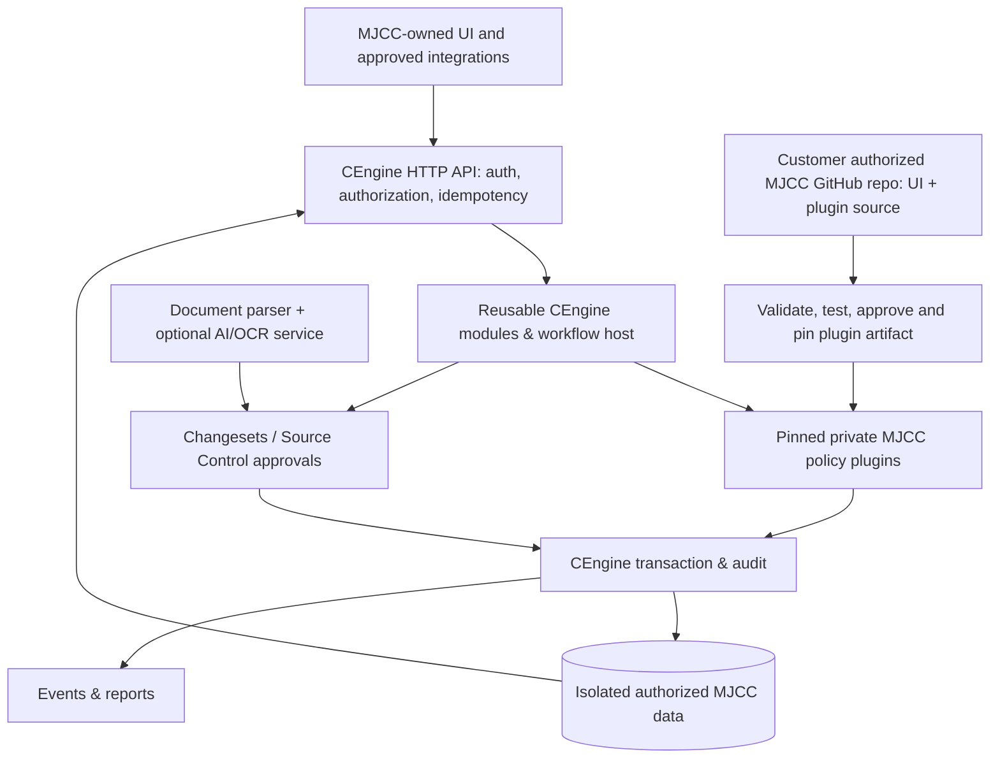
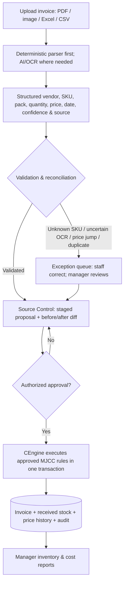
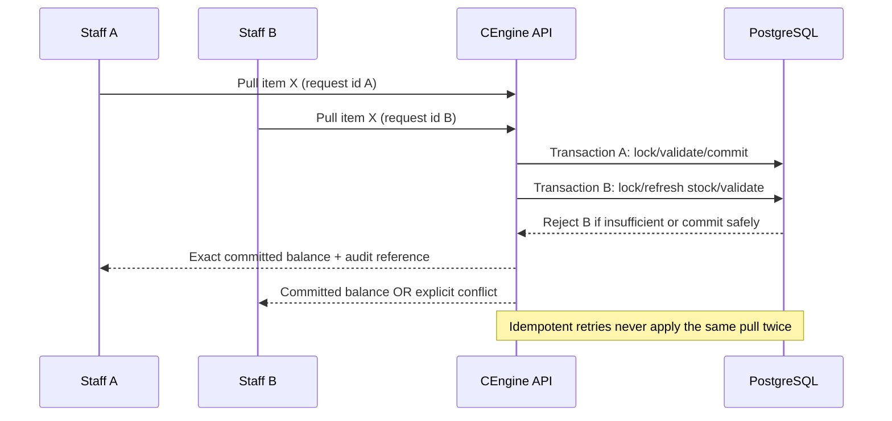

# MJCC on CEngine: Complete Food-Service Operations Blueprint

**Status:** Implementation blueprint and verification plan, **not evidence of completed migration or authorization to cut over**.  
**Owner direction recorded:** 2026-10-12  
**Source of authority:** KpnDream/loom accepted ADRs and explicit customer/owner approvals; this document does not supersede them.

## Executive decision

MJCC (Miami Job Corps Center food-service department) is a **complete cafeteria operations workspace**, not a QR inventory demo or an invoice parser. The goal is to preserve and improve the current Compute application while **moving the authoritative backend execution to a single CEngine HTTP API**, with MJCC-specific business policies provided by **approved, version-pinned, manually authored plugins** in its separate authorized repository. CEngine remains a reusable proprietary Rust library **and** a hosted execution API. No Persona or global Templates V1 registry is needed for the first deployment.

**Order:** Inventory everything the existing Compute application actually does → complete all backend modules/plugins and data parity in CEngine → prove end-to-end workflows on staging → owner/staff verify synced results → then modernize the UI → independently approve production cutover.

Do not quietly downgrade functional requirements to a small demo. No authenticated inspection of the running MJCC UI, live database verification, or full production parity is claimed by this document.

## 1. The restaurant/kitchen analogy: who does what?

Think of the system as a professional kitchen:

- **MJCC UI is the service counter.** Staff submit and inspect work. It should not invent stock figures or directly alter accounting behind the counter.
- **CEngine HTTP API is the expediter.** Every authorized business command passes one controlled point that assigns the job, checks permissions, and returns the authoritative result.
- **CEngine core and shared modules are kitchen equipment and standardized procedures.** Transactions, identity, records, quantities, periods, audit, approvals, documents, events, barcodes, reporting and reliable concurrency can work for many organizations.
- **MJCC plugins are the cafeteria's recipe cards.** Their three-week calendar, historical opening-cost rule, 25% price-review decision, invoice matching policy, manager approval conditions and applicable food-safety SOPs are specific to this customer. These rules are versioned and executable by CEngine without modifying its core.
- **AI extraction is the invoice-reading clerk.** It transcribes and suggests structured values. It neither approves its own guesses nor writes the final ledger.
- **Source Control is the manager's review desk.** Proposed stock changes are compared, corrected and approved before posting.
- **The main database is the ledger and stockroom record.** Only accepted, transactionally consistent changes enter.
- **Audit logs are the signed shift book.** They preserve who did what, when, under which plugin/version and approval.

### Diagram A: definitive backend



**Hard boundary:** No old FastAPI business calculator hidden behind the new API. Legacy services may be read-only or temporary, explicitly listed migration adapters until replaced. GitHub stores customer plugin *source*, not transactional data or code fetched live for every request.

### Diagram B: the invoice conveyor belt



**Never allow AI confidence to bypass staging and approval.** Deterministic text parsing remains available when AI is offline. File content and extracted suggestions must be traceable, correctable, idempotent and reconciled to the original invoice.

## 2. Scope from a food-service manager's day

The manager needs a complete daily workflow, not disconnected endpoints.

| Operational moment | Staff/manager job | Current Compute source areas to inspect | CEngine reusable capability | MJCC plugin/policy |
| --- | --- | --- | --- | --- |
| Open kitchen | Opening and equipment checklists, exceptions, assignments | `DailyOps`, `Operations`, `backend/routes/logs.py` | Tasks, logs, state, sign-off | Required checklist/SOP steps and escalation |
| Receive goods | Scan SKU/QR, vendor invoice, condition, quantity, temperature, receipt | `inventory.py`, `data_entry.py`, invoice parser, barcode tables | Records, document imports, stock movements, barcode lookup | Receiving acceptance, matching, pack conversion, delivery exceptions |
| Issue/consume stock | Authorized pulls, accountability, low stock, stock location/lot | `PullSheet`, inventory, barcode/master tables | Inventory and tracking | Three-week pull rules, no silent shortfalls |
| Prepare/service | Cycle menus, meal counts, ingredient availability, substitution, service records | `CycleMenu`, `menu.py`, daily logs | Menus, records, scheduling | Meal-cycle and program rules |
| Safety checks | HACCP temperature, corrective actions, sanitation, sign-off | `ComplianceHub`, `ServSafeManager`, `logs.py` | Validated observations, alerts, audit | **Customer-approved food-safety limits**, corrective-action escalation; don't invent regulatory thresholds |
| Handle issues | Price outliers, unknown SKU, duplicate document, edits pending approval | `PriceReview`, `SourceControl`, `sku_review` | Changesets, queues, approvals | 25% price-review rule, reviewer scopes |
| Sell/serve extras | Snack bar product catalog, sales, adjustments | `SnackBarShop`, `snack_bar.py` | Products, transactions, reports | MJCC prices and corrections |
| End day/month | Reconcile movements, closing counts, invoice amounts, audit, print/CSV, rollover | `Reports`, `cost.py`, `inventory_formulas.py`, `periods.py` | Queries, report projections, period lifecycle | Carryover costs, valuation, publication and correction conditions |
| Plan ahead | Reorder suggestions, trends, cost spikes, menu support, reminders | `AIStudio`, `AgentChat`, `data_entry`, `agent.py` | Read-only analytics, events, scheduled jobs | Customer-approved triggers and recommendations |

Review roles: staff, assistant, manager, admin and any legacy `sudo` mappings must be mapped and tested. A present screen or route is **not** proof it works.

### Additional requirements to verify with management

Receiving temperature/condition, storage locations, expiration/FEFO, lot-level recalls, ingredient allergens, meal counts, waste, substitutions, sanitation schedules, equipment maintenance, food service certification, inspections, ordering and vendor issues are plausible capabilities. **Do not mark them as existing or promise them at launch without confirming MJCC's actual SOPs and scope.** Put each in one of: **required for first go-live / later enhancement / not applicable**.

## 3. Current Compute evidence, discrepancies and risks

Observed in repository source as of 2026-10-12 (not authenticated deployment):

- `PRODUCT.md` explicitly describes MJCC as a manager/staff cafeteria operations portal, covering inventory, HACCP, events, menus and monthly reports.
- `backend/routes/` contains inventory, data entry, price review, SKU review, Source Control, logs, menus, events, snack bar, cost, AI agent, files, staff authentication and workspace routes.
- Frontend components include `PullSheet`, `PriceReview`, `CycleMenu`, `DailyOps`, `ComplianceHub`, `Reports`, `DataEntry`, `SourceControl`, `SnackBarShop`, `ServSafeManager`, `AIStudio`.
- `backend/inventory_formulas.py` and `backend/pricing.py` currently rely on Python `float` and `round`. Replace monetary semantics in CEngine with decimal/fixed-precision **after** agreeing a documented rounding policy and confirming exact results on golden fixtures. Test rounding edge cases; migration must not silently change booked historical amounts.
- `backend/pricing.py` uses a 25% observed price-change threshold and a 0.005 near-equality tolerance; it holds suspect price observations for review.
- `backend/inventory_formulas.py` distinguishes raw negative stock/value audit signals from nonnegative displayed balances and preserves old over-pull evidence. New invalid writes must not worsen over-pulls; do not erase inherited audit exceptions.
- Opening stock valuation carries previous period opening unit cost where present, distinct from new observed monthly price. Received/pulled pricing and legacy value drift have several historical nuances; use the **latest code + actual DB + approved workbook fixtures**, not any one stale comment, to determine final parity.
- Latest application code enforces **three operational weeks**. Old `DB.md` text still describes four and other legacy columns. Verify live schema and record a canonical migration mapping before editing. The database stores month 0-indexed while the API accepts 1-indexed months.
- `backend/concurrency.py` has a process-local inventory lock and a bounded stale snapshot read path; these are not sufficient on their own for multiple server replicas. Replace with DB-backed concurrency/version controls and idempotency. Do not accept data loss from simultaneously entered pulls or invoice commits.
- `backend/routes/data_entry.py` has a deterministic-first/AI-supported extraction and review pipeline. Preserve it, including file archive and Source Control.
- Existing README and `AGENTS.md` describe Render, API gateway, Supabase Auth/service role and tenant boundaries; deployed state must be verified. The legacy `AGENTS.md` instruction to test against production **must not be followed for destructive tests**: use an isolated authorized staging database.
- Legacy `DB.md` is historically scoped; do not treat embedded old row counts, vendor setup or assistant snippets as fresh production evidence.
- Current CEngine `spec/plugins.md` and PR #65 describe an approved digest-pinned policy-pack installation and the `ce-serve` host path; do not infer full MJCC parity or a deployed public API from successful local plugin tests.

## 4. Formula parity contract, then safe improvement

For each line and three-week period:

```text
total_received = w1_received + w2_received + w3_received
total_pulled   = w1_pulled + w2_pulled + w3_pulled
raw_ending_oh  = opening_oh + total_received - total_pulled
displayed_stock = max(0, raw_ending_oh)
overpull_excess = max(0, total_pulled - opening_oh - total_received)
opening_value  = round_cents(opening_oh * carried_opening_unit_cost)
received_value = round_cents(total_received * approved_period_price)
pulled_value   = round_cents(total_pulled * approved_period_price)
ending_value   = 0 if displayed_stock == 0 else
                 max(0, round_cents(opening_value + received_value - pulled_value))
```

These are an **overview of current read-path semantics**, not a complete legal/accounting policy or substitute for legacy source, stored financial columns, invoice price provenance and audit exceptions. Compare against actual backend functions for every edge case. Keep raw residual and adjustment fields for reconciliation. Zero stock must not retain misleading positive displayed value. Period publishing must block unresolved applicable price reviews and drift. Rollover must be idempotent and carry forward the agreed correct cost basis.

**Three example parity vectors to include:**
1. Normal receipt/pull across weeks, verified ending quantity and cent valuation.
2. Price changes just below/at/above 25%, plus half-cent tolerance, manager hold and audit.
3. Over-pull attempt, historical over-pull evidence, displayed stock, raw discrepancy and period close/reopen.

**Hard rules:** Never use floats for new financial decisions. Store quantities in appropriate exact units and typed decimals; define pack conversion separately. Run old-vs-new golden tests over anonymized or authorized data; capture differences to the cent and require deliberate decision on any change.

## 5. Plugin strategy and separation

**CEngine generic reusable primitives:** typed records/entity schema, inventory movements, invoice register, decimal money, query, files, import staging, changesets, approval states, tasks/checklists, events, barcode identifiers, reporting/export, transaction engine, role authorization and audit. Reuse existing CEngine crates where possible; avoid one crate per screen.

**MJCC plugin packs:** version-pinned `.cengine/plugins/<slug>/plugin.toml` policy packs describing the existing three-week inventory rules, valuation and price-review thresholds, receiving validation, SKU rules, manager approval transitions, period closing and food-safety SOPs. Author manually now; future Persona uses the same host contracts only on authorized user requests.

**Do not make rule differences up just to demonstrate hooks.** If MJCC's rule equals a built-in default, prove that its installed plugin is resolved/pinned/audited and use a separate synthetic *alternate plugin* to demonstrate pluggability without modifying CEngine source.

### QR/barcode tracking isn't just a graphic

A scanned identifier should resolve to a catalog item, and optionally a unique physical package/lot if customer scope requires it. An opaque QR code identifies the item/stock object; authenticated CEngine calls retrieve description, SKU, quantity, location and history. A QR must not contain private credentials or stock counts. Test create → print → scan → receive/pull → plugin calculation → atomic database write → report; unknown/duplicate/unauthorized scan, retry and simultaneous scans must fail safely. Check existing `item_barcodes`, `barcodes`, and `inventory_items.barcode_id` before designing new tables.

## 6. Source Control is an operational approval system

**Never skip:** `Upload → parse/OCR/AI → compare and reconcile → stage → preview old/new → staff corrections and manager authorization → CEngine atomic business execution → main MJCC database + event/audit → reporting`.

Source Control is a Git-like *application changeset workflow*, not necessarily a GitHub commit for every inventory transaction. GitHub controls the private plugin source and installation provenance. Source Control governs customer operational data. A staged batch is **not** committed stock.

Reconciliation includes invoice subtotal, extracted lines and expected quantities, vendor/SKU canonicalization, unit conversions, duplicate file/line hashes, missing SKU queue, suspicious price observations, historical affected periods and approval version. A manager can reject or correct proposals; accepted values must be posted exactly once. Reject multi-partial writes without clear recovery semantics.

## 7. Multi-user, safety, latency and reliability

- **Concurrency:** PostgreSQL transactions with row/version locking or serializable/retry strategy as justified; idempotency key on every POST/commit/import and unique movement identity. Two staff scans cannot double-decrement stock or lose an edit. Test two+ app replicas against one DB and overlapping workloads.
- **Scope/security:** resolve signed caller identity; enforce tenant and installation on every query/write; roles for assistant/manager/staff, field scope on sensitive data, audit of permission changes. Never embed service-role key in browser.
- **Plugin safety:** descriptor schema, digest pin, persist approved installation, fail closed on invalid/missing plugin, safe rollback retaining historical rule hashes, resource budget, no network/external database calls in policy packs.
- **Money/stock:** atomic invoice+movement+price events and audit, no floats in new engine formulas, immutable historic finance and provenance; anomalies visible rather than silently clamped away.
- **Availability:** retries do not duplicate transactions; unavailable AI/OCR delays extraction but does not corrupt existing posted stock; offline GitHub does not stop approved runtime plugin; measured load/latency targets from staged baseline, not invented SLA.
- **Safety/compliance:** HACCP temperature and corrective action thresholds MUST be supplied/approved by qualified MJCC personnel and matched to applicable program requirements; no automatic certification of compliance by AI.
- **Data privacy:** preserve staff and student/privacy constraints, protect invoice files, validate uploads, no real customer records in public test fixtures or future global template gallery.
- **Backup/restore:** test a complete restore, include attachment storage, migrations, plugin/version history, report outputs and recovery checklist.

### Diagram C: two employees submit simultaneously



## 8. AI/automation: the clerk, not the accountant

Keep the existing AI-powered invoice workflow because its purpose is to save managers time. Use deterministic document parsing first when reliable, OCR/vision or a chosen AI model for scans and ambiguous documents, and manual review for uncertain fields. Record source, confidence, correction and approval. Customer-approved AI may later answer inventory questions, suggest par levels and reorders, draft reports, detect unusual invoice prices/temperature trends and schedule reminders. CEngine alone commits financial and compliance facts. AI availability and cost must not block normal manual daily operations.

Do **not** require Persona or a Claude call for every CEngine transaction.

## 9. Full backend-before-UI plan and PR sequence

**P0: Current-state baseline.** Inspect real current Compute backend, frontend, DB and live instance via authorized read-only access, plus MJCC-workspace and CEngine. Inventory every route and screen; report: exists, works, broken, missing, proposed. Read current `CHANGELOG.md` and repository governance instructions. Link code evidence and observed UI evidence separately.

**P1: Real plugin hosting and API.** Verify v0.2.0 release, approve/pin and persist MJCC plugin, compose live server manifest, prove real custom policy invocation, role/tenant safety, HTTP/Postgres tests. No v0.2.0 tag alone proves MJCC readiness.

**P2: Financial and source-control parity.** Bring three-week inventory, invoice staging, SKU review, observed-price protocol, manager changesets, historical valuation, period close and rollover into CEngine with golden tests.

**P3: Complete operational backend.** Food-safety logs, daily checklists, menus, events, snack bar, QR tracking, reports, printing/export, file archive and staff accounts; define required vs later scope with manager.

**P4: Multiuser and reliability.** Concurrency/load at realistic staff volume, replay/idempotency, outage handling, scoped authorization, QA and recovery.

**P5: Staging deployment and owner acceptance.** Deploy CEngine HTTP API and MJCC test client on authorized hosting, isolated DB and storage, migrations, HTTPS, monitored readiness; demonstrate full-day and month-end simulations. Owner/manager checks each operation and sees persisted synchronized results.

**P6: UI update.** Only after backend acceptance: integrate/refine UI around verified API, preserve accessibility, printing and efficient manager/staff roles. Re-run all end-to-end tests.

**P7: Separate production release verdict.** Reconcile live history, back up and restore, compare key numbers, verify rollback, agree downtime/support, obtain explicit customer/owner approval, then cut over and monitor.

Split implementation into focused PRs by tested capability. Documentation alone is not a milestone completion. **No authorization to deploy, change the live MJCC database, or switch traffic is conveyed by this PR.**

## 10. Acceptance scenarios (must execute end to end)

1. Manager opens dashboard, reviews required checklists/temperature exceptions, assigns work.
2. Staff receives a vendor invoice PDF, deterministic/AI extraction finds items; uncertain SKU/large price rise is held; corrections are staged; manager approves; exact receiving quantity/value and invoice are committed once; source file and audit can be retrieved.
3. Staff scans a QR for an item, pulls stock; balance and period report update; duplicate request does not double-decrement.
4. Two staff members pull the same low-stock item concurrently; one succeeds/other receives correct updated availability or both succeed only when valid; no oversell or lost update.
5. Manager corrects an observed price with required review; prior closed month does not silently change.
6. Manager prints month report; three-week totals, prices and opening carryover reconcile to agreed golden outputs.
7. HACCP exception is captured with approved threshold and required corrective action; audit identifies who acted and when.
8. Menu/cycle, event, daily log, snack-bar and export flows work, based on required-scope roster.
9. API/worker restarts, GitHub unavailable, AI extraction unavailable, invalid plugin digest, token expiration and failed network request yield predictable behavior without corruption.
10. A full staging migration + database/file backup restore succeeds; customer staff sign off before launch.

For each scenario produce: **request trace, code commit, test command, CI URL, plugin/version/digest, expected and actual quantities/amounts, DB/audit evidence, result, and remaining limitation**. Never include secrets or real private user information in PRs.

## 11. Readiness board and handoff

Maintain an explicit matrix:

| Requirement | Legacy UI/code | Live verified? | CEngine/module | MJCC plugin | CI tested? | Staging tested? | Owner accepted? | Blocker / PR |
| --- | --- | --- | --- | --- | --- | --- | --- | --- |
| Inventory 3-week | audit | unknown | audit | audit | unknown | unknown | no | investigate |
| AI invoice → Source Control → database | audit | unknown | implement | implement | unknown | unknown | no | investigate |
| QR/barcode tracking | partial source | unknown | implement | confirm | unknown | unknown | no | investigate |
| HACCP, daily ops, menus, reports, snack bar | source routes/components | unknown | map | map | unknown | unknown | no | investigate |
| Multiuser, role isolation, rollback | partial source | unknown | verify | verify | unknown | unknown | no | investigate |

**Owner's review checkpoint:** CEngine's *entire approved MJCC backend* must work and synchronize in staging before the substantial UI update. A production cutover is a separate explicit decision.

**Claude/Codex assignment:** Audit all three implementation repositories and Loom; report code-vs-live gaps, then implement the smallest highest-impact backend PRs with tests. Be proactive within approved branch permissions, but do not create extra architecture-only PRs, touch live data, invent customer SOPs, or skip the release/cutover gates.
