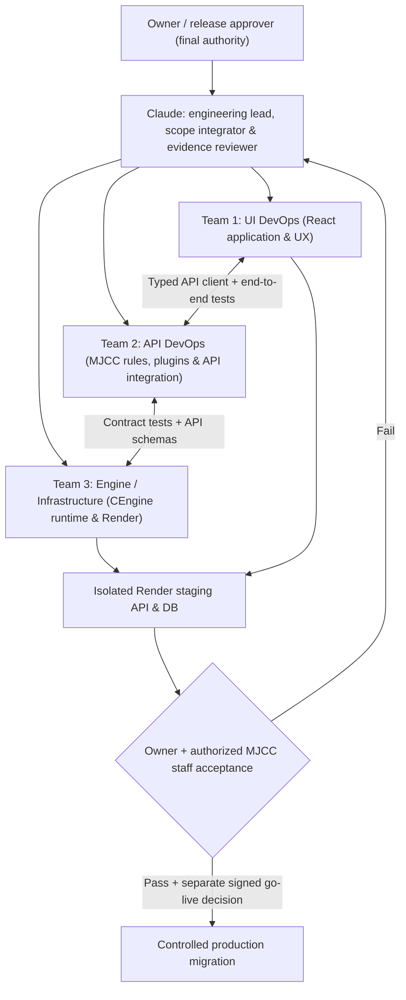
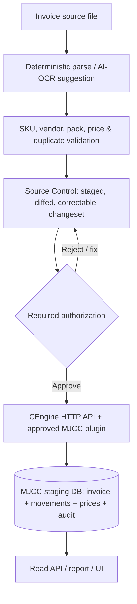
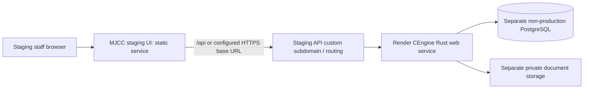

# MJCC Migration: Three-Team Execution Contract and Render Staging Runbook

**Status:** Proposed operating instructions for Claude and its delegated agents. **Documentation only; no deployment or production-cutover approval.**  
**Date:** 2026-10-12  
**Authority:** Loom ADR-0009 (actual repository is `KpnWorld/MJCC-workspace`; the ADR text contains an older `MJJC` spelling), ADR-0007/0008, current owner instructions, and [CEngine blueprint PR #67](https://github.com/KpnSolute/CEngine/pull/67).

## Objective

Finish the full MJCC food-service operations backend on **CEngine's hosted Rust HTTP API and customer-private, approved plugins**, then have the owner validate all data and workflows in staging, **then** modernize/connect the MJCC UI, and only after independent customer/owner approval switch production.

### Division of labor: three teams, one API contract

Think of the teams as a cafeteria service: **UI runs the counter**, **API DevOps translates approved cafeteria procedures into recipes and orders**, and **Engine/Infrastructure builds and maintains the dependable kitchen equipment**. They own different components, but a plate only counts as complete when it travels through the full service line and matches the order.

### Team 1: UI DevOps

**Repository:** `KpnWorld/MJCC-workspace`, future `ui/`. Read legacy `KpnSolute/Compute/frontend` without changing Compute main.

Own:
- Inventory of all current screens, user actions, roles, user paths, accessibility, printouts, mobile/QR scanning and dashboards; label **existing / partial / broken / proposed**.
- Preserve manager/staff operational workflows: invoice upload/preview, Source Control queue, SKU review, price review, inventory by three weeks, receipt/pull, period close, HACCP, checklists, menus, events, snack bar, reports and admin settings.
- Define UI-to-API request/response contracts with API DevOps and build a *thin typed client* with mocks and contract tests; no local accounting engine, direct DB write or business-rule duplication.
- Prepare minimal staging test UI and a screen-parity catalog now; **major UI redesign begins only after backend owner-acceptance checkpoint**.
- Later: production-quality responsive accessible UI, clear audit/errors, QR scanning, confirmation previews, and reporting/printing. Re-run end-to-end tests against deployed API.

Deliverables: screen/action matrix, UI API contract and tests, minimal owner-verification test interface, then accepted UI implementation PRs. Never claim a screen's backend works because it renders.

### Team 2: API DevOps: MJCC Plugins & Business Workflow Implementations

**Repository:** `KpnWorld/MJCC-workspace/plugin/` and `golden/`; coordinate reusable API capability PRs with Team 3 in `KpnSolute/CEngine`.

Own:
- Extract **all current Compute formulas and policies**, including three-week opening/received/pulled/ending calculations, historical opening-cost carry, quantity-governed ending value, raw discrepancy/over-pull, SKU and vendor matching, price observations and the 25% manager-review threshold; document every input/rounding behavior and get owner approval for deliberate changes.
- Implement and version **customer-private approved digest-pinned policy packs**. Preserve the already reviewed MJCC plugin; audit and finish PR #2, update/pin compatible CEngine v0.2.1 after verifying its API/version and run actual golden fixtures in MJCC CI. Do not merge PR #2 automatically.
- Build the **AI invoice pipeline**: original PDF/Excel/CSV/image → deterministic parser / optional OCR/AI extraction → structured proposals with provenance → duplicate/SKU/pack/price reconciliation → *MJCC Source Control staging* → manager review and approval → single atomic CEngine posting → database and audit reconciliation. AI cannot post direct ledger writes.
- Implement requirements for catalog/QR/barcode item tracking, movement history, vendor/invoice workflow, HACCP, daily tasks/checklists, menus, events, snack bar, period lifecycle, reports and exports with reusable CEngine modules. Food-safety thresholds and newly proposed modules need customer-SOP validation and governance where material.
- Produce exact-decimal financial behavior with compatibility vectors, tests at half-cent/25% boundaries, historical negative signal preservation, rollover tests, authorization/tenant isolation and replay-safe idempotent imports.
- Own every migrated endpoint's expected request/response schema and the test that proves the API calls **CEngine rather than FastAPI calculations**.

Deliverables: inventory route-to-operation parity map; versioned plugin descriptors, signed-off business rules, fixtures, passing golden CI, Source Control integration tests, traceable end-to-end acceptance vectors.

### Team 3: Engine and Infrastructure DevOps

**Repositories:** `KpnSolute/CEngine` for generic reusable engine; `KpnWorld/MJCC-workspace` for customer staging configuration only. **The owner and ChatGPT will jointly choose and configure Render settings, domain and routing; Claude prepares the exact technical requirements but must not assume deployment approval.**

Own:
- Inspect CEngine v0.2.1 release, verify reusable engine capabilities and patch missing generic workflows (transactions, changesets, approvals, inventory/receiving, decimal money, documents/files, QR identity, periods, auth, query, audit and reporting) with tested PRs. Avoid duplicating MJCC-only policies in shared core.
- Prove `ce-serve` can install the **exact approved MJCC plugin bytes** and serve real HTTP operations using persistent install/approval state; fail closed on wrong digest/version and exercise backup/rollback.
- Implement safe multi-replica execution: database transactions, row/version consistency, unique idempotency keys, bounded reads, tenant-scoped RLS/permissions, safe retries and concurrency/load testing. Audit how old Compute process-local locks and 60-second cached reads affect parity.
- Prepare reproducible Rust build/container and Render staging blueprint, environment-variable inventory, health/readiness checks, database migrations, telemetry, rate limits, secret management, networking, TLS, support, rollback and storage persistence.
- Provide a staging health API and domain/routing integration to UI DevOps; measure response latency and simulated multi-staff loads; do not invent SLOs.
- Supply cost estimates and identify any paid Render/database/DNS provisioning requests **before executing them**.

Deliverables: tested CEngine PRs, immutable release/plugin pin, deployment configuration PR, isolated staging smoke tests, monitoring and backup/restore evidence, owner-friendly Render setup instructions.

## Shared architectural invariants

**No Source Control bypass; no direct frontend writes; no production data in the new repository; no production migration tests.** CEngine remains both a proprietary Rust library and HTTP service. The legacy FastAPI backend stays operational for existing users until explicit cutover. No new runtime LLM requirement: AI suggestions are optional; deterministic calculations are mandatory.

## Team coordination, branching and PR order

**Lead Claude** delegates only where agents/tools actually exist. At every checkpoint, publish a concise evidence table with **implemented / tested / deployed / verified / blocked** and links to real commits, tests, workflow runs and staging request traces.

1. **Baseline (cross-team, no speculative rewrite):** Compare Compute source, approved live read-only behavior if accessible, MJCC-workspace main and open PR #2, CEngine v0.2.1, Loom ADRs and the [full blueprint](https://github.com/KpnSolute/CEngine/pull/67). Record the complete screen/API/formula/DB gap matrix. Do not mistake plans or old DB docs for running truth.
2. **PR track A (API DevOps):** Align MJCC valuation/price/invoice plugin with CEngine v0.2.1; automate goldens; complete Source Control staging and commit parity.
3. **PR track B (Engine):** Fill missing generic HTTP workflows and persisted transaction/approval functions in independently tested engine PRs, with contract-test fixtures agreed with API DevOps.
4. **PR track C (UI):** Create standalone UI skeleton/client contracts and manager test harness while API/Engine teams work. **No major redesign before owner approves backend parity.**
5. **PR track D (Backend completeness):** Operational modules, QR, safety, checklists, menus, sales, reports, multi-user reliability and exact-decimal parity. Split per coherent feature, each with real tests.
6. **PR track E (Staging):** Reproducible Render deploy and isolated DB, staging domain, secure routing, logs, health and end-to-end smoke tests; only after owner authorizes relevant host/resource operations.
7. **PR track F (Acceptance):** Manager full-day and month-end simulations with evidence, owner checks synchronization and signs off backend. UI team then implements/refines full UI; repeat acceptance. Finally request **separate** production go-live verdict.

Do not merge other teams' PRs, modify Compute main, alter approved ADRs, provision paid resources, or deploy production without the exact applicable authorization. Use independent feature branches/worktrees, keep PRs small and label which team owns each. If a release requires changing `CEngine`, pin tested commits/tags; never invent a release.

## Render rollout: owner-guided, non-production first

**Proposed shape:**

### Render launch checklist (owner and ChatGPT together)

1. **Choose actual staging names and host:** Decide whether to use existing Render account/service or create a new **isolated** Rust web service. Choose a staging-only API name such as `api-staging.<owner-controlled-domain>` only after verifying the owner controls DNS; this is illustrative, **not a claim of an existing domain**.
2. **Prepare engine build:** Dockerfile/entrypoint, correct `ce-serve` command, persistent pinned plugin installation, `PORT` binding to `0.0.0.0`, minimum CPU/RAM/disk and build-time/runtime secrets. Render has an ephemeral service filesystem by default; approval records and other persistent state must use durable storage or an explicitly documented supported persistence design. Validate current Render features/plan before pricing or setup.
3. **Isolated data:** Choose a staging PostgreSQL instance (Render Postgres or independent Supabase staging project), configure TLS, migration versioning, least privilege, and private object storage; **never use MJCCv1 production service-role values**. Test fresh install, restart and backup restore.
4. **Owner-mediated setup:** Claude provides exact field values (without secret contents) for service name, GitHub repo, branch, root directory, Dockerfile, health check, region, environment-variable **names**, application startup, database URL location and expected `/health`/readiness behavior discovered from the real Rust routes. Owner explicitly approves provisioning and pastes secrets privately into Render. Do **not** post secrets in PRs or chat.
5. **API host:** Deploy to Render's generated `*.onrender.com` URL first; verify TLS, health, real authenticated API requests, approved plugin execution and DB persistence **before attaching any custom domain**.
6. **Domain and routing:** In Render add the chosen custom API domain for that web service. In the authoritative DNS provider create exactly the Render-prescribed CNAME/A/verification records, check DNS resolution and Render-managed certificate issuance. Configure MJCC staging UI to call the **verified HTTPS origin**, configure CORS to the specific UI origin, and decide whether to use a reverse proxy for same-origin `/api` routes. DNS does not automatically handle `/api` path rewriting; implement/test an actual proxy or use an absolute API base URL. Do not repoint existing production `api.kpnsolute.com` or `compute.kpnsolute.com` without go-live verdict.
7. **Operational proof:** Verify externally reachable staging UI → CEngine API → approved plugin → staging DB → correct returned record, with traces/logs, restart behavior, failed plugin, duplicate invoice, role/tenant denial, parallel user write, backup restore and measured response times.
8. **Owner checkpoint:** Provide the user a simple clickable staging endpoint, safe test accounts, complete acceptance checklist, known limitations, and the exact Render/DNS settings used. Do not call production-ready before signed manager/owner acceptance and full UI parity.

### Owner questions to resolve with ChatGPT before provisioning

- Which Render account/organization and region should host staging?
- Which DNS provider and domain/subdomain is intended for staging? Is control verified?
- Which non-production database and document storage will be used, and are there budget limits?
- Who are the authorized reviewers for the plugin, backend acceptance, and final production cutover?

These are **staging infrastructure decisions**, not blockers to safe source analysis, plugin development, or local tests.

## Explicit go-live stop sign

Loom ADR-0009 requires a separate go-live verdict. A passing CEngine v0.2.1 release, merged plugin PR, or Render health endpoint is **not** enough. Before any production DNS switch, client traffic migration or live database write, obtain owner and designated customer authorization based on: all workflows reconciled, exact-money golden tests, approved plugin digest, Source Control through committed storage, security and tenant review, full staged data migration, concurrent-user/retry tests, backup *restore*, failed deployment rollback, actual staff acceptance, expected downtime, monitoring and support.

**First instruction to Claude:** Read this PR and CEngine blueprint PR #67, inspect current repos and Loom, appoint the three teams, produce a clear ownership/PR dependency matrix, start the highest-priority unblocked **code** task, and reserve Render/domain changes for an interactive owner-guided session.
